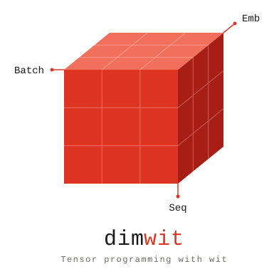

# DimWit - Tensor programming with wit

<table>
<tr>
<td width="40%" align="center">
  
</td>
<td>
  <p><i>“Programming is the art of telling another human being what one wants the computer to do.”</i><br>— Donald Knuth</p>
  <p><b>Vision:</b> A system for writing numerical and machine learning programs that puts human understanding first. While programming, the compiler should help us to keep concepts separate and sharpen our thinking about the problem.</p>
  <p>▶ Watch the <a href="https://www.youtube.com/watch?v=2ZwGhCWXN5g">ScalaDays 2026 talk</a>.</p>
</td>
</tr>
</table>

## Why DimWit?

Why yet another tensor library? With untyped tensors, the meaning of each axis lives only in the programmer's head. DimWit puts it into the types, e.g. `Tensor2[Batch, Feature, Float32]`, without sacrificing runtime speed:

- **Easier to understand.** Concepts become types, so the compiler helps keep them apart, sharpening the thinking about the problem.
- **Easier to review.** The meaning of each axis is part of the code, streamlining code reviews, which matters all the more in the era of AI-generated code.
- **Names are a shared vocabulary.** Axes like `Batch` or `Feature` name the concepts of the domain, so the code reads close to the theory behind it. They become a shared vocabulary for your team and your AI agents, whether you discuss code, review it or prompt for it.
- **Fast.** DimWit is on par with JAX: under `jit`, a function is traced once and the compiled XLA program runs without Scala in the loop. [GPT-2 in DimWit](https://github.com/dimwit-dev/deepwit/tree/main/examples/src/main/scala/deepwit/examples/gpt) (124M parameters, trained from scratch on 10B tokens) trains as fast as in plain JAX.

## Example

A minimal example of what named dimensions add to a tensor program, next to the same program in JAX:

<table>
<tr><th>DimWit</th><th>JAX</th></tr>
<tr>
<td>

```scala
// The axis names are the shared vocabulary
trait Batch derives Label
trait Feature derives Label
trait Output derives Label

// f has a strict signature: mapping a feature vector to an output vector
def f(x: Tensor1[Feature, Float32]): Tensor1[Output, Float32] = ...

// Tensor types carry meaning and are tracked by the compiler
val X: Tensor2[Batch, Feature, Float32] = ...
val Y: Tensor2[Batch, Output, Float32] =
  X.vmap(Axis[Batch])(f) // the axis by name, not position
```

</td>
<td>

```python


def f(x: Tensor) -> Tensor: ...


X: Tensor = ...
Y: Tensor = (
  jax.vmap(f, in_axes=0)(X))
```

</td>
</tr>
</table>

In DimWit, the names state the intent of the code; in JAX, the reader has to infer it from axis positions.


See our [quickstart guide](docs/quickstart.md) for a more detailed introduction to the core concepts and API and 
check out the [examples](examples/src/main/scala).

## Using DimWit as a Library

### Requirements

- Scala **3.9** or newer
- sbt **1.11** or newer

### Installation

Add to your `build.sbt` (minimal complete example):

```scala
ThisBuild / scalaVersion := "3.9.0"

lazy val myProject = (project in file("."))
  .settings(
    name := "my-project",
    libraryDependencies ++= Seq(
      "ch.contrafactus" %% "dimwit-core" % "0.2.0"
    ),
    fork := true
  )
```

### Python Environment Setup

DimWit requires **Python 3.9+** and **JAX** since it uses JAX as the backend for tensor operations via ScalaPy. It also relies on **Einops** for tensor reshaping and manipulation.

The easiest way to set up the Python environment is to install the [uv package manager](https://github.com/astral-sh/uv) and add a `pyproject.toml` to your **project root** (the directory where you run `sbt`):

```toml
[project]
name = "my-project-python-env"
version = "0.1.0"
requires-python = "==3.13.*"
dependencies = [
    "einops>=0.8.1",
    # Use jax[cpu] for CPU-only environments (e.g. development/CI without a GPU)
    # Use jax[cuda12] for NVIDIA GPU support
    "jax[cpu]>=0.8.2",
]
```

DimWit provides the command `dimwit.initialize()` which you can call at the start of your application to automatically set up the Python environment. This will check for the required dependencies and set the necessary environment variables for ScalaPy.

```scala 
import dimwit.*

@main def runApp(): Unit = {
    // Initialize the Python environment for DimWit
    dimwit.initialize()

    println(Tensor0(42.0f)) 
}   
```

Alternatively, you can configure the Python environment manually using these environment variables:

- `DIMWIT_PYTHON_PATH` — path to the Python executable (find it with `which python3` or `uv run python -c "import sys; print(sys.executable)"`)
- `DIMWIT_PYTHON_LIBRARY` — path to the Python shared library (find it with `python3 -c "import ctypes.util; print(ctypes.util.find_library('python3'))"`)
- `DIMWIT_SKIP_SYNC` — set to `true` to skip uv environment sync on startup

## Scope

Like JAX, DimWit is a library for fast numerical programming: tensors, automatic differentiation, `vmap`, `jit` and random numbers.
Everything else is built on top of it:

| Project | Description |
|---|---|
| [DeepWit](https://github.com/dimwit-dev/deepwit) | Functional deep learning library providing core modules and examples. |
| [WitDraw](https://github.com/dimwit-dev/witdraw) | Experimental library for probabilistic programming. |

## Status 

**Ready to use.** The core concepts are stable and the API is maturing, but breaking changes may still happen until 1.0.

## Contributing

If your interests align with our vision, we would love to have you on board! Feel free to open issues or pull requests on GitHub.